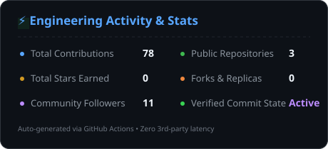
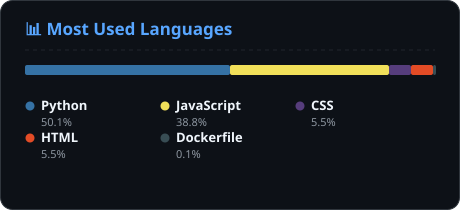

<div align="center">

# Hi there, I'm Vaibhav Sharma 👋

### ⚡ AI/ML Engineer & Systems Builder

[](https://www.linkedin.com/in/vaibhavsharma45)
[](https://vaibhavsharma45.github.io)
[](https://medium.com/@vaibhavsharma95124v)
[](https://leetcode.com/u/Vaibhavsharma045)
[](mailto:vaibhavsharma95124v@gmail.com)

<p align="center">
  <em>Building production-ready Machine Learning architectures, LLM-powered workflows, and scalable backend APIs.</em>
</p>

</div>

---

### 👨‍💻 About Me

- 🎓 **MCA Candidate (2028)** at Jaypee Institute of Information Technology (JIIT).
- 🧠 **Applied AI & ML**: Specializing in end-to-end predictive pipelines, multi-modal feature fusion, and LLM inference engines (Groq / Llama 3.3).
- ⚙️ **Backend & Systems**: Engineering modular microservices and RESTful APIs using **FastAPI** and **Flask**, containerized with **Docker** and verified through automated test suites.
- 🔭 **Current Focus**: Architecting self-updating data pipelines, open-source developer tooling, and explainable decision-support systems.

---

### 🛠️ Tech Stack & Tooling

```
Core Languages    │ Python • JavaScript (ES6+) • SQL • HTML5 • CSS3 • Bash
AI & Data Science │ Scikit-Learn • Pandas • NumPy • SciPy • Plotly • Seaborn • Groq API (Llama 3.3)
Backend & APIs    │ FastAPI • Flask • Pydantic • RESTful APIs • Gunicorn
Database & Storage│ PostgreSQL • MySQL • SQLite
DevOps & Cloud    │ Docker • Git • GitHub Actions • Render • Postman
Reporting Tools   │ ReportLab (Automated PDF) • python-pptx (Executive Presentations)
```

<p align="center">
  
  
  
  
  
  
  
  
  
  
</p>

---

### 🚀 Featured Engineering Projects

| Project | Architecture & Tech Stack | Description | Links |
| :--- | :--- | :--- | :---: |
| **CareerPath AI** | `FastAPI` • `Scikit-Learn` • `React 18` • `Docker` • `O*NET 31.0` | Multi-modal career recommendation engine fusing 7 psychometric traits with 300-D NLP goal narratives against official US DOL O*NET taxonomies across 5 benchmarked classifiers. 18 automated unit tests. | [**Code**](https://github.com/Vaibhavsharma45/Career_path) |
| **DataMind Pro** | `Flask` • `Groq API (Llama 3.3)` • `Pandas` • `Scikit-Learn` • `Render` | Autonomous data analysis platform automating end-to-end exploratory analysis, ML regression/classification, AI narrative generation, and PDF/PowerPoint report exports. | [**Code**](https://github.com/Vaibhavsharma45/-Auto-Data-Analysis) • [**Live**](https://datamind-pro.onrender.com) |
| **Portfolio Data Pipeline** | `Node.js 20` • `GitHub Actions` • `GraphQL` • `GitHub Pages` | Automated cron-driven ETL pipeline synchronizing live repository metrics, contribution graphs, and developer achievements directly into a decoupled portfolio client. | [**Code**](https://github.com/Vaibhavsharma45/Vaibhavsharma45.github.io) |

---

### 📊 Engineering Stats & Language Distribution

<div align="center">
  
  
</div>

<br/>

<div align="center">
  
</div>

---

### ⚡ Recent Engineering Activity

<!-- RECENT_ACTIVITY:START -->
- 🚀 **2026-11-09**: Created branch on [`Career_path`](https://github.com/Vaibhavsharma45/Career_path)
<!-- RECENT_ACTIVITY:END -->

---

### 📦 Latest Repositories

<!-- LATEST_REPOS:START -->
- 📦 [**Career_path**](https://github.com/Vaibhavsharma45/Career_path) (`JavaScript`) — AI / Engineering project. ★ `0`
- 📦 [**-Auto-Data-Analysis**](https://github.com/Vaibhavsharma45/-Auto-Data-Analysis) (`Python`) — AI / Engineering project. ★ `0`
<!-- LATEST_REPOS:END -->

---

### ✍️ Articles & Publications

<!-- BLOG_POSTS:START -->
✍️ *Engineering deep-dives and AI articles coming soon on [Medium (@vaibhavsharma95124v)](https://medium.com/@vaibhavsharma95124v)!*
<!-- BLOG_POSTS:END -->

---

### 📬 Connect With Me

- **Email**: [vaibhavsharma95124v@gmail.com](mailto:vaibhavsharma95124v@gmail.com)
- **LinkedIn**: [linkedin.com/in/vaibhavsharma45](https://www.linkedin.com/in/vaibhavsharma45)
- **Medium**: [medium.com/@vaibhavsharma95124v](https://medium.com/@vaibhavsharma95124v)
- **LeetCode**: [leetcode.com/u/Vaibhavsharma045](https://leetcode.com/u/Vaibhavsharma045)
- **Portfolio**: [vaibhavsharma45.github.io](https://vaibhavsharma45.github.io)

<div align="center">
  <sub>Generated with zero third-party external dependencies • SVGs committed and served natively via GitHub Actions</sub>
</div>
